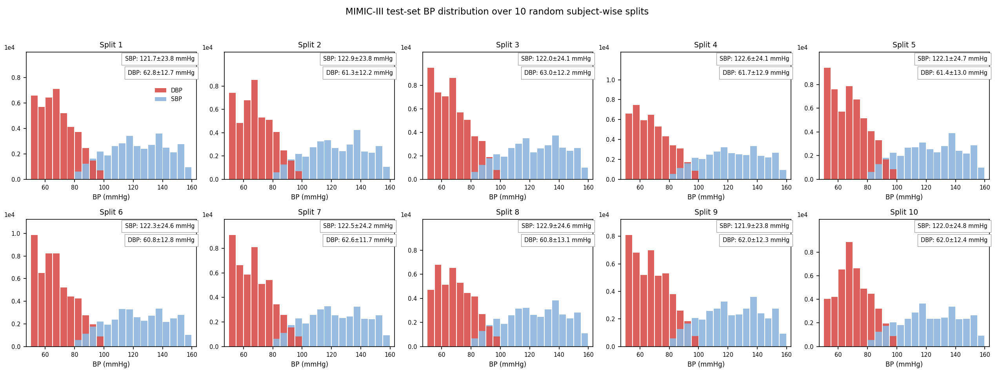
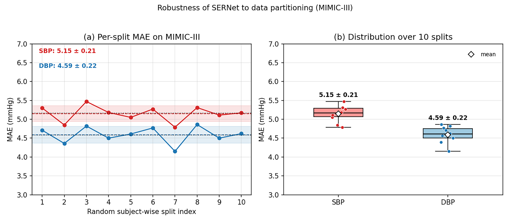

# Supplementary experiments

This folder is reserved for supplementary experiments associated with SERNet.

# Robustness to Data Partitioning: Ten Random Subject-wise Splits (MIMIC-III)

Ten independent random subject-wise splits were performed on the MIMIC-III dataset. In each split, subjects were divided into training, validation, and test sets at a ratio of 6:2:2 with strictly disjoint subjects across the three sets , and the model was trained and evaluated independently, in order to verify that the reported performance does not depend on a particular partition.The blood pressure (BP) distribution of the test sets across the ten random subject-wise splits is shown in the figure below.

In (a), the polylines show the per-split MAE (red: SBP; blue: DBP); the horizontal dashed lines denote the mean over the ten splits; the shaded bands denote mean ± 1 SD; and the black dotted lines indicate the single-split results reported in Table IV (SBP 5.16 / DBP 4.58 mmHg). In (b), the box spans the interquartile range (IQR), the inner black line is the median, the diamond is the mean, and the dots are the ten individual split results. The per-split MAEs fluctuate randomly around their means, indicating that the performance of SERNet is insensitive to data partitioning and is stably reproducible. results, indicating that the performance of SERNet is insensitive to data partitioning and is stably reproducible.

# Component-wise Ablation Study

This document extends the six-case ablation of Table VI with three additional
component-isolation variants (Cases 5, 7, 8) that separately verify the Siamese
structure, the reference BP term, and the uncertainty-driven confidence gating.
Cases 1–4, 6, and 9 are identical to Cases 1–6 in Table VI of the paper;
Case 5 (Siamese only), Case 7 (Refer = 0), and Case 8 (Fixed Gate) are the
newly added isolation variants. All variants share the same subject-wise
partitions (6:2:2, disjoint subjects) and training protocol as the main model.

## PPG-BP dataset

| Case | SBP MAE (mmHg) | SBP ME±SDE (mmHg) | DBP MAE (mmHg) | DBP ME±SDE (mmHg) |
|---|:---:|:---:|:---:|:---:|
| Case 1: CNN-LSTM | 6.76 | -2.25±9.22 | 5.47 | -1.76±7.85 |
| Case 2: CNN-LSTM+XLSTM | 6.10 | 0.43±8.60 | 5.11 | -1.09±7.13 |
| Case 3: CNN-LSTM+XLSTM+Fusion | 5.83 | -0.36±8.11 | 4.84 | -0.85±6.91 |
| Case 4: CNN+KFM-LSTM+XLSTM+Fusion | 5.41 | 0.31±8.06 | 4.35 | 0.57±6.24 |
| Case 5: Case 4+Siamese | 5.21 | 0.74±7.59 | 4.18 | -0.62±5.53 |
| Case 6: Case 4+Evidence | 5.22 | 0.83±7.66 | 4.18 | -0.41±5.69 |
| Case 7: Case 4+Siamese Evidential (Refer=0) | 5.30 | 0.75±6.92 | 4.06 | 0.84±5.50 |
| Case 8: Case 4+Siamese Evidential (Fixed Gate) | 4.94 | -0.61±6.75 | 3.90 | 0.23±5.66 |
| Case 9: Case 4+Siamese Evidential (SERNet, full) | 4.45 | -0.29±6.81 | 3.71 | 0.41±5.38 |

## MIMIC-III dataset

| Case | SBP MAE (mmHg) | SBP ME±SDE (mmHg) | DBP MAE (mmHg) | DBP ME±SDE (mmHg) |
|---|:---:|:---:|:---:|:---:|
| Case 1: CNN-LSTM | 8.32 | -2.16±9.78 | 6.75 | 1.21±8.53 |
| Case 2: CNN-LSTM+XLSTM | 7.46 | -1.68±9.12 | 5.94 | -0.91±8.69 |
| Case 3: CNN-LSTM+XLSTM+Fusion | 6.45 | 0.96±9.30 | 5.53 | 0.92±8.22 |
| Case 4: CNN+KFM-LSTM+XLSTM+Fusion | 5.78 | -0.45±8.41 | 5.06 | -0.80±7.87 |
| Case 5: Case 4+Siamese | 5.50 | 0.62±8.15 | 4.77 | 0.65±7.43 |
| Case 6: Case 4+Evidence | 5.56 | 0.38±8.13 | 4.82 | 1.03±6.82 |
| Case 7: Case 4+Siamese Evidential (Refer=0) | 5.42 | -0.79±8.06 | 4.75 | 1.16±6.55 |
| Case 8: Case 4+Siamese Evidential (Fixed Gate) | 5.33 | -0.51±8.12 | 4.71 | -0.76±6.72 |
| Case 9: Case 4+Siamese Evidential (SERNet, full) | 5.16 | -0.49±7.92 | 4.58 | 0.62±6.40 |

## Brief analysis

- **Siamese path and evidential regression are complementary.** Used alone,
  the Siamese path (Case 5) and the evidential head (Case 6) each improve over
  Case 4 ;
  combining both with confidence gating (Case 9) produces by far the largest
  gain.
- **Reference BP is indispensable (Case 7 vs. Case 9).** Zeroing the reference
  BP in the gating formula degrades the SBP MAE from 4.45 to 5.30 mmHg
  (PPG-BP) and from 5.16 to 5.42 mmHg (MIMIC-III), confirming that the
  Siamese path exploits genuine cross-subject reference information rather
  than trivial BP proximity.
- **Uncertainty-driven gating outperforms fixed fusion (Case 8 vs. Case 9).**
  Replacing the per-sample gate with a fixed weight degrades the
  SBP/DBP MAE by 0.49/0.19 mmHg (PPG-BP) and 0.17/0.13 mmHg (MIMIC-III),
  demonstrating that adaptively trusting the less uncertain path on a
  per-sample basis is the key to fusing the absolute and differential paths.
